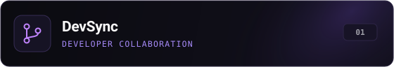
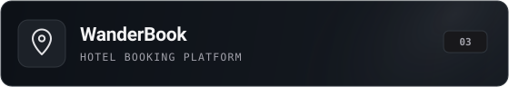

<!-- ========================================================================= -->
<!-- HERO SECTION                                                              -->
<!-- ========================================================================= -->

  <!-- Custom Dark Gray SVG Banner -->
  

    

  <!-- Dynamic Typing Subtitle -->
  

    

  <!-- Quick Navigation / Social Pills -->
  
  &nbsp;
  
  &nbsp;
  

 

 

<!-- ========================================================================= -->
<!-- ABOUT ME                                                                  -->
<!-- ========================================================================= -->

### About Me

I'm **Aashirwad Singh**, a **Software Developer** focused on building scalable, production-ready web applications with clean architecture and dependable engineering.

- **Production Engineering:** Experience working on real-world projects and production applications from design to deployment.
- **Systems & Architecture:** Interested in clean architecture, reliable backend systems, AI integrations, and modern developer tools.
- **Continuous Growth:** Actively strengthening Data Structures & Algorithms (DSA) and exploring AI engineering.

 

 

<!-- ========================================================================= -->
<!-- TECH STACK                                                                -->
<!-- ========================================================================= -->

### Tech Stack

<table width="100%">
  <tr>
    <td width="50%" align="center" valign="top">
      
<strong>Frontend</strong>

      
        
      <code>React</code> · <code>Next.js</code> · <code>TypeScript</code> · <code>JavaScript</code> · <code>HTML</code> · <code>CSS</code> · <code>Tailwind CSS</code>
    </td>
    <td width="50%" align="center" valign="top">
      
<strong>Backend</strong>

      
      
        
      <code>Node.js</code> · <code>Express.js</code> · <code>MongoDB</code> · <code>PostgreSQL</code> · <code>Socket.io</code>
    </td>
  </tr>
  <tr>
    <td width="50%" align="center" valign="top">
      
<strong>Tools</strong>

      
        
      <code>Git</code> · <code>GitHub</code> · <code>Postman</code> · <code>VS Code</code> · <code>Vercel</code>
    </td>
    <td width="50%" align="center" valign="top">
      
<strong>Exploring</strong>

      
        
      <code>AI</code> · <code>RAG</code> · <code>LangChain</code> · <code>System Design</code>
    </td>
  </tr>
</table>

 

 

<!-- ========================================================================= -->
<!-- FEATURED PROJECTS                                                         -->
<!-- Replace the #featured-projects placeholder hrefs and tech stack tags      -->
<!-- below with your live repository and deployment URLs.                      -->
<!-- ========================================================================= -->

<h3 id="featured-projects">Featured Projects</h3>

<table width="100%">
  <tr>
    <td width="50%" valign="top">
      
      

        A GitHub-inspired developer collaboration platform built for streamlined code workflows and team coordination.
      

      

        <strong>Stack:</strong> <code>[Add Tech Stack]</code>
      

      

        <!-- TODO: Replace with actual DevSync repository and live demo URLs -->
        <a href="#featured-projects">GitHub Repository (Placeholder)</a> &nbsp;·&nbsp;
        <a href="#featured-projects">Live Demo (Placeholder)</a>
      

    </td>
    <td width="50%" valign="top">
      
      

        A real-time video conferencing application enabling peer-to-peer rooms and live signaling via WebRTC and Socket.io.
      

      

        <!-- TODO: Append any additional frontend/backend technologies used -->
        <strong>Stack:</strong> <code>WebRTC</code> · <code>Socket.io</code>
      

      

        <!-- TODO: Replace with actual EchoMeet repository and live demo URLs -->
        <a href="#featured-projects">GitHub Repository (Placeholder)</a> &nbsp;·&nbsp;
        <a href="#featured-projects">Live Demo (Placeholder)</a>
      

    </td>
  </tr>
  <tr>
    <td width="50%" valign="top">
      
      

        A hotel booking web application designed for intuitive stay discovery, listing management, and reservation flows.
      

      

        <strong>Stack:</strong> <code>[Add Tech Stack]</code>
      

      

        <!-- TODO: Replace with actual WanderBook repository and live demo URLs -->
        <a href="#featured-projects">GitHub Repository (Placeholder)</a> &nbsp;·&nbsp;
        <a href="#featured-projects">Live Demo (Placeholder)</a>
      

    </td>
    <td width="50%" valign="top">
      
      

        A job-related web application built to connect candidates with opportunities and simplify application workflows.
      

      

        <strong>Stack:</strong> <code>[Add Tech Stack]</code>
      

      

        <!-- TODO: Replace with actual Jobbr repository and live demo URLs -->
        <a href="#featured-projects">GitHub Repository (Placeholder)</a> &nbsp;·&nbsp;
        <a href="#featured-projects">Live Demo (Placeholder)</a>
      

    </td>
  </tr>
</table>

 

 

<!-- ========================================================================= -->
<!-- CONTRIBUTIONS                                                             -->
<!-- Snake SVG is generated onto the `output` branch via .github/workflows/snake.yml -->
<!-- ========================================================================= -->

### Contributions

  <picture>
    <source media="(prefers-color-scheme: dark)" srcset="https://raw.githubusercontent.com/aashirwad89/aashirwad89/output/github-snake-dark.svg?v=2" />
    <source media="(prefers-color-scheme: light)" srcset="https://raw.githubusercontent.com/aashirwad89/aashirwad89/output/github-snake.svg?v=2" />
    
  </picture>

 

 

<!-- ========================================================================= -->
<!-- CONNECT WITH ME                                                           -->
<!-- ========================================================================= -->

### Connect With Me

  
  &nbsp;
  
  &nbsp;
  
  &nbsp;
  <!-- TODO: Replace with your email address -->
  

 

<!-- ========================================================================= -->
<!-- FOOTER                                                                    -->
<!-- ========================================================================= -->

  

