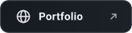
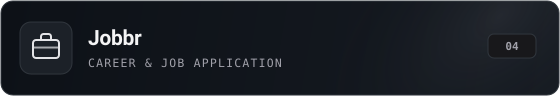

<!-- ========================================================================= -->
<!-- HERO SECTION                                                              -->
<!-- ========================================================================= -->

  <!-- Custom Dark Obsidian & Violet SVG Banner -->
  

    

  <!-- Dynamic Typing Role Subtitle -->
  

    

  <!-- Quick Navigation / Social Pills -->
  
  &nbsp;
  
  &nbsp;
  

 

 

<!-- ========================================================================= -->
<!-- ABOUT ME                                                                  -->
<!-- ========================================================================= -->

### About Me

I'm **Aashirwad Singh**, a **Full Stack Developer** and **Software Engineer** passionate about designing and shipping scalable, production-ready web applications with clean aesthetics and resilient engineering under the hood.

- **Production Engineering:** Experience building and maintaining real-world web applications from architecture to deployment.
- **Systems & Architecture:** Deeply interested in clean architecture, reliable backend systems, AI integrations, and modern developer tools.
- **Continuous Growth:** Actively sharpening Data Structures & Algorithms (DSA) and exploring applied AI engineering.
- **Portfolio:** Explore my work and background at [portfolio-aashirwad.vercel.app](https://portfolio-aashirwad.vercel.app).

 

 

<!-- ========================================================================= -->
<!-- TECH STACK                                                                -->
<!-- ========================================================================= -->

### Tech Stack

<table width="100%">
  <tr>
    <td width="150" valign="middle"><strong>Frontend</strong></td>
    <td valign="middle">
      
       
      React &nbsp;·&nbsp; Next.js &nbsp;·&nbsp; TypeScript &nbsp;·&nbsp; JavaScript &nbsp;·&nbsp; HTML &nbsp;·&nbsp; CSS &nbsp;·&nbsp; Tailwind CSS
    </td>
  </tr>
  <tr>
    <td width="150" valign="middle"><strong>Backend</strong></td>
    <td valign="middle">
      
       
      Node.js &nbsp;·&nbsp; Express.js &nbsp;·&nbsp; MongoDB &nbsp;·&nbsp; PostgreSQL &nbsp;·&nbsp; Socket.io
    </td>
  </tr>
  <tr>
    <td width="150" valign="middle"><strong>Tools</strong></td>
    <td valign="middle">
      
       
      Git &nbsp;·&nbsp; GitHub &nbsp;·&nbsp; Postman &nbsp;·&nbsp; VS Code &nbsp;·&nbsp; Vercel
    </td>
  </tr>
  <tr>
    <td width="150" valign="middle"><strong>Exploring</strong></td>
    <td valign="middle">
      AI Engineering &nbsp;·&nbsp; Retrieval-Augmented Generation (RAG) &nbsp;·&nbsp; LangChain &nbsp;·&nbsp; System Design
    </td>
  </tr>
</table>

 

 

<!-- ========================================================================= -->
<!-- FEATURED PROJECTS                                                         -->
<!-- Replace the #featured-projects placeholder hrefs and tech stack tags      -->
<!-- below with your live repository and deployment URLs.                      -->
<!-- ========================================================================= -->

<h3 id="featured-projects">Featured Projects</h3>

<table width="100%">
  <tr>
    <td width="50%" valign="top">
      
      

        A GitHub-inspired developer collaboration platform built for streamlined code workflows and team coordination.
      

      

        <strong>Stack:</strong> <code>[Add Tech Stack]</code>
      

      

        <!-- TODO: Replace with actual DevSync repository and live demo URLs -->
        <a href="#featured-projects">GitHub Repository (Placeholder)</a> &nbsp;·&nbsp;
        <a href="#featured-projects">Live Demo (Placeholder)</a>
      

    </td>
    <td width="50%" valign="top">
      
      

        A real-time video conferencing application enabling peer-to-peer rooms and live signaling via WebRTC and Socket.io.
      

      

        <!-- TODO: Append any additional frontend/backend technologies used -->
        <strong>Stack:</strong> <code>WebRTC</code> · <code>Socket.io</code>
      

      

        <!-- TODO: Replace with actual EchoMeet repository and live demo URLs -->
        <a href="#featured-projects">GitHub Repository (Placeholder)</a> &nbsp;·&nbsp;
        <a href="#featured-projects">Live Demo (Placeholder)</a>
      

    </td>
  </tr>
  <tr>
    <td width="50%" valign="top">
      
      

        A hotel booking web application designed for intuitive stay discovery, listing management, and reservation flows.
      

      

        <strong>Stack:</strong> <code>[Add Tech Stack]</code>
      

      

        <!-- TODO: Replace with actual WanderBook repository and live demo URLs -->
        <a href="#featured-projects">GitHub Repository (Placeholder)</a> &nbsp;·&nbsp;
        <a href="#featured-projects">Live Demo (Placeholder)</a>
      

    </td>
    <td width="50%" valign="top">
      
      

        A job-related web application built to connect candidates with opportunities and simplify application workflows.
      

      

        <strong>Stack:</strong> <code>[Add Tech Stack]</code>
      

      

        <!-- TODO: Replace with actual Jobbr repository and live demo URLs -->
        <a href="#featured-projects">GitHub Repository (Placeholder)</a> &nbsp;·&nbsp;
        <a href="#featured-projects">Live Demo (Placeholder)</a>
      

    </td>
  </tr>
</table>

 

 

<!-- ========================================================================= -->
<!-- GITHUB STATISTICS                                                         -->
<!-- ========================================================================= -->

### GitHub Statistics

  
  &nbsp;
  

    

  

 

 

<!-- ========================================================================= -->
<!-- CONTRIBUTIONS & ACTIVITY                                                  -->
<!-- Note: The snake SVG below is generated by .github/workflows/snake.yml     -->
<!-- onto the `output` branch. Run that workflow once after pushing to enable. -->
<!-- ========================================================================= -->

### Contributions & Activity

  

    

  <!-- Contribution Snake Animation (generated via .github/workflows/snake.yml) -->
  <picture>
    <source media="(prefers-color-scheme: dark)" srcset="https://raw.githubusercontent.com/aashirwad89/aashirwad89/output/github-snake-dark.svg" />
    <source media="(prefers-color-scheme: light)" srcset="https://raw.githubusercontent.com/aashirwad89/aashirwad89/output/github-snake.svg" />
    
  </picture>

 

 

<!-- ========================================================================= -->
<!-- CONNECT WITH ME                                                           -->
<!-- ========================================================================= -->

### Connect With Me

  
  &nbsp;
  
  &nbsp;
  
  &nbsp;
  <!-- TODO: Replace with your email address -->
  

 

<!-- ========================================================================= -->
<!-- FOOTER                                                                    -->
<!-- ========================================================================= -->

  

