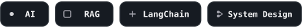

<!-- ========================================================================= -->
<!-- HERO SECTION                                                              -->
<!-- ========================================================================= -->

  <h1>Hi, I'm Aashirwad Singh</h1>

  
Code. Learn. Build. Repeat. 💻

  <!-- Dynamic Typing Subtitle -->
  

    

  <!-- Quick Navigation / Social Pills -->
  
  &nbsp;
  
  &nbsp;
  

 

 

<!-- ========================================================================= -->
<!-- ABOUT ME                                                                  -->
<!-- ========================================================================= -->

### About Me

I'm **Aashirwad Singh**, a **Software Developer** focused on building scalable, production-ready web applications with clean architecture and dependable engineering.

- **Production Engineering:** Experience working on real-world projects and production applications from design to deployment.
- **Systems & Architecture:** Interested in clean architecture, reliable backend systems, AI integrations, and modern developer tools.
- **Continuous Growth:** Actively strengthening Data Structures & Algorithms (DSA) and exploring AI engineering.

 

 

<!-- ========================================================================= -->
<!-- TECH STACK                                                                -->
<!-- ========================================================================= -->

### Tech Stack

<table width="100%">
  <tr>
    <td width="50%" align="center" valign="top">
      
<strong>Frontend</strong>

      
        
      <code>React</code> · <code>Next.js</code> · <code>TypeScript</code> · <code>JavaScript</code> · <code>HTML</code> · <code>CSS</code> · <code>Tailwind CSS</code>
    </td>
    <td width="50%" align="center" valign="top">
      
<strong>Backend</strong>

      
      
        
      <code>Node.js</code> · <code>Express.js</code> · <code>MongoDB</code> · <code>PostgreSQL</code> · <code>Socket.io</code>
    </td>
  </tr>
  <tr>
    <td width="50%" align="center" valign="top">
      
<strong>Tools</strong>

      
      
        
      <code>Git</code> · <code>GitHub</code> · <code>Postman</code> · <code>VS Code</code> · <code>Vercel</code> · <code>Hetzner</code>
    </td>
    <td width="50%" align="center" valign="top">
      
<strong>Exploring</strong>

      
        
      <code>AI</code> · <code>RAG</code> · <code>LangChain</code> · <code>System Design</code>
    </td>
  </tr>
</table>

 

 

<!-- ========================================================================= -->
<!-- CONNECT WITH ME                                                           -->
<!-- ========================================================================= -->

### Connect With Me

  
  &nbsp;
  
  &nbsp;
  
  &nbsp;
  <!-- TODO: Replace with your email address -->
  

 

<!-- ========================================================================= -->
<!-- FOOTER                                                                    -->
<!-- ========================================================================= -->

  

